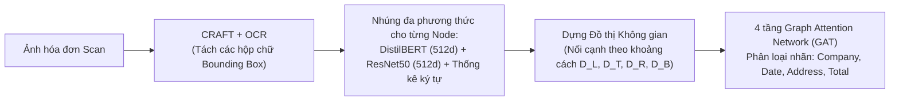

# Giải Mã Cơ Chế Kỹ Thuật Từng Công Trình Chủ Chốt Của TS. Bùi Thanh Hùng

Tài liệu này giúp bạn **hiểu tận gốc cơ chế bên trong** các bài báo và mã nguồn GitHub của thầy Hùng. Mỗi tài liệu đều được bóc tách theo 4 tầng: **Bài toán -> Kiến trúc & Cơ chế -> Công thức cốt lõi -> Cách bạn ứng dụng vào thực chiến**.

---

## Tài liệu 1: `ConBGAT` (PeerJ CS, 2024) — Trích Xuất Thông Tin Từ Ảnh Hóa Đơn / Chứng Từ Scan
- **Tên đầy đủ:** *ConBGAT: A novel model combining convolutional neural networks, transformer and graph attention network for information extraction from scanned image*
- **Liên hệ trực tiếp với bạn:** Rất sát nghiệp vụ **Fintech / Ngân hàng** (đọc biên lai, hóa đơn GTGT, hợp đồng, giấy tờ KYC).

### 1. Tại sao OCR thông thường thất bại trên hóa đơn?
Nếu chỉ chạy OCR rồi nối chữ từ trái qua phải để đưa vào BERT/LLM truyền thống, cấu trúc cột của hóa đơn bị vỡ vụn (ví dụ chữ `"Tổng thanh toán"` ở bên trái nhưng con số `"1.250.000đ"` nằm tít bên phải hoặc lệch dòng khi giấy bị nhăn).

### 2. Cơ chế 4 bước của `ConBGAT`

1. **Phát hiện vùng chữ & OCR:** Dùng mạng **CRAFT** khoanh vùng từng cụm chữ (mỗi cụm chữ là 1 **Node** trên đồ thị), sau đó dùng Tesseract/EasyOCR đọc chuỗi ký tự bên trong.
2. **Tạo vector đặc trưng đa phương thức (Multimodal Node Embedding):** Mỗi Node không chỉ có chữ mà là tổng hợp của **3 nguồn thông tin**:
   - **Ngữ nghĩa văn bản (`DistilBERT`, 512 chiều):** Hiểu chữ `"Total"` gần nghĩa với `"Tổng cộng"`.
   - **Đặc trưng hình ảnh cục bộ (`ResNet50` + FC, 512 chiều):** Nhìn được chữ đó **in đậm, cỡ chữ to hay màu đỏ** (ví dụ số tiền tổng thường in đậm hơn các dòng món ăn).
   - **Đặc trưng thống kê ký tự & bố cục:** Tỷ lệ chữ số, chữ hoa, ký hiệu tiền tệ, kích thước hộp chữ.
3. **Dựng đồ thị láng giềng không gian (Spatial Graph Construction):**
   - Mỗi hộp chữ nối cạnh với các hộp chữ gần nhất theo 4 hướng (Trái, Trên, Phải, Dưới) với trọng số cạnh là khoảng cách tương đối chuẩn hóa $(D_L, D_T, D_R, D_B)$.
4. **Mạng Graph Attention Network (4 tầng GAT):**
   - Các Node tự học trọng số chú ý ($\alpha_{ij}$) lên các Node hàng xóm. Nhờ đó, Node `"1.250.000"` nhìn sang trái thấy Node `"TỔNG CỘNG"` nên biết chắc chắn mình mang nhãn `TOTAL` chứ không phải giá từng món lẻ!
- **Kết quả:** Đạt **97.40% F1** trên tập hóa đơn `SROIE`, **96.72% F1** trên `CORD`, chỉ tốn **45M tham số** (nhẹ hơn 3.4 lần so với DocTr 153M).

---

## Tài liệu 2: `Global-Local Hybrid VLM + Intrinsic XAI` (Discover AI, 2026)
- **Tên đầy đủ:** *A global-local hybrid vision-language framework for interpretable grapevine disease diagnosis* (File PDF nằm trong `papers_pdf/`).
- **Ý nghĩa lớn:** Đây là hình mẫu chuẩn mực nhất về cách thầy Hùng kết hợp **Xử lý ảnh cổ điển + LLM đa phương thức (VLM) + Giải thích hộp đen (XAI)** và chống học vẹt!

### 1. Hiện tượng "Clever Hans" (Học vẹt nền ảnh) mà bài báo giải quyết
Các mạng CNN như `EfficientNet-B4` đạt tới **99.8%** trên ảnh chụp phòng thí nghiệm (`PlantVillage` nền xám sạch đẹp), nhưng khi mang ra chụp ngoài đời thực (`PlantDoc` vướng đất đá, nắng gắt, tay người cầm) thì độ chính xác **tụt thảm hại xuống 54.9%** (rơi mất 44.9%) vì model học vẹt màu nền chứ không nhìn vào vết bệnh!

### 2. Cơ chế 3 tầng độc đáo
1. **Tự động cắt vùng nghi ngờ không cần gán nhãn (Unsupervised Saliency Auto-Crop):**
   - Đổi ảnh RGB sang không gian màu **CIE-LAB** (tách độ sáng $L^*$ khỏi hai kênh màu $a^*, b^*$).
   - Tính bản đồ nổi bật (Saliency Map):
     $$S(x, y) = W_A a^*(x, y) + W_L (1 - L^*(x, y)) + W_B b^*(x, y)$$
   - Dùng phân ngưỡng tự động **Otsu** + phép đóng/mở hình thái học (Morphological Opening/Closing) để khử nhiễu, rồi tính **Moment hình ảnh** $(\bar{x}, \bar{y}) = (m_{10}/m_{00}, m_{01}/m_{00})$ tìm đúng tâm vùng bất thường, cắt ra một miếng ảnh chi tiết **$128 \times 128$ (Local Patch)**.
2. **Kiến trúc hai luồng thị giác (Dual-Stream VLM + 4-bit QLoRA):**
   - Đưa đồng thời **Ảnh toàn cảnh $256 \times 256$ (`V_global`)** VÀ **Ảnh cận cảnh $128 \times 128$ (`V_local`)** qua bộ mã hóa `CLIP ViT-L/14` (mỗi ảnh ra 576 visual tokens), ghép chung với câu lệnh văn bản `T_prompt`:
     $$\text{Input Sequence} = [V_{\text{global}} \oplus V_{\text{local}} \oplus T_{\text{prompt}}]$$
   - Tinh chỉnh mô hình `LLaVA-1.5 7B` bằng **4-bit NF4 QLoRA** ($r=64, \alpha=128$, chỉ huấn luyện 7.68% tham số trên 2 card T4).
3. **Giải thích nội tại (Intrinsic XAI qua Cross-Attention):**
   - Gắn `Forward Hook` vào tầng giải mã cuối cùng (tầng 31) của Transformer, lấy trung bình ma trận Cross-Attention giữa token chẩn đoán và lưới ảnh $24 \times 24$:
     $$\bar{A} = \frac{1}{H} \sum_{h=1}^{H} A_{\text{mat}}^{(h)}$$
   - Phóng đại (bilinear upsampling) phủ ngược lên ảnh gốc thành bản đồ nhiệt (Heatmap) để người dùng thấy tận mắt AI đang nhìn đúng vào vết hỏng chứ không nhìn nền!
- **Kết quả & Khoảng trống để bạn khai thác:** Giữ vững **80.5%** khi đem ra ảnh thực địa nhiễu nặng (so với 54.9% của CNN). **Tuy nhiên**, chính tác giả chỉ ra hạn chế là **độ trễ ~2.23 giây/ảnh trên Cloud** — đây chính là cơ hội vàng để bạn đưa bước **Auto-Crop & Tiền xử lý xuống Mobile Android Edge**!

---

## Tài liệu 3: `ExVQA` (2025) & `Interactive VQA` (2026) — Hỏi Đáp Thị Giác Thế Hệ Mới
- **Mã nguồn thực tế đã kiểm tra:** `https://github.com/Hovohoangduy/ExVQA`

### 1. Cơ chế `ExVQA` (Kết hợp SigLIP + Stacked Attention + xLSTM)
Đọc trực tiếp từ các file `vqa_model.py`, `sans.py`, `xlstm_decoder.py` trong repo của học trò thầy:
- **Mã hóa ảnh (`features_extraction.py`):** Dùng `google/siglip-base-patch16-224` (đóng băng trọng số `torch.no_grad()`, vector `768` chiều) — SigLIP dùng hàm loss Sigmoid thay vì Softmax của CLIP nên bắt chi tiết cục bộ tốt hơn.
- **Mã hóa câu hỏi:** Đưa qua `EleutherAI/gpt-neo-125m` rồi đẩy vào khối **`mLSTM` (Matrix LSTM thuộc kiến trúc xLSTM mới)** với 8 attention heads.
- **4 tầng Stacked Attention Networks (`sans.py`):** Lặp 4 lần phép chiếu $\text{GELU}(W_i v_i + W_q v_q)$ + Softmax để câu hỏi "soi" đi "soi" lại nhiều bước trên các vùng của bức ảnh (ví dụ bước 1 tìm "cái xe màu đỏ", bước 2 nhìn "biển số của cái xe đó").
- **Bộ giải mã `xLSTM` (`xlstm_decoder.py`):** Kết hợp `CausalConv1D` và bộ nhớ ma trận `mLSTM`/`sLSTM` để sinh câu trả lời tự nhiên mà chi phí bộ nhớ tuyến tính theo độ dài chuỗi.

### 2. Cơ chế `Interactive VQA` (IJEECS, 2026)
- Thay vì bắt AI lúc nào cũng phải rặn ra một câu trả lời (dễ bịa đặt khi ảnh chụp bị mờ hoặc câu hỏi thiếu ngữ cảnh), hệ thống kết hợp **Bộ nhớ hội thoại (Conversational Memory)** + **Module sinh câu hỏi làm rõ (Clarification Question Generation)**.
- Ví dụ thực tế: Khi ảnh biên lai bị ngón tay che mất ngày giao dịch, AI không đoán bừa mà chủ động hỏi ngược lại: *"Phần ngày tháng ở góc phải đang bị che khuất, bạn xác nhận giúp giao dịch này diễn ra hôm nay phải không?"*

---

## Tài liệu 4: `KGRec` (PLOS ONE, 2026) — Hệ Thống Gợi Ý Dựa Trên Đồ Thị Tri Thức
- **Mã nguồn thực tế đã kiểm tra:** `https://github.com/TrinhDuongHoan/KGREC_implementation` (`models/KGRec.py`)

### Cơ chế hoạt động (Dành cho bài toán Gợi ý sản phẩm / Gói tài chính / Nội dung)
1. **Đồ thị Tri thức Cộng tác (Collaborative Knowledge Graph - CKG):** Gộp chung lịch sử tương tác *(User A -> đã mua -> Sản phẩm X)* với đồ thị tri thức thuộc tính *(Sản phẩm X -> thuộc danh mục -> Bảo hiểm sức khỏe)*.
2. **Nhúng quan hệ bằng `TransR`:** Mỗi loại quan hệ $r$ có một ma trận chiếu riêng $W_r$ để biến đổi thực thể đầu $e_h$ và thực thể đuôi $e_t$ sang không gian của quan hệ đó:
   $$g(h, r, t) = \| W_r e_h + e_r - W_r e_t \|_2^2$$
3. **Bộ gom thông tin song tương tác (`Bi-Interaction Aggregator` trong `KGRec.py`):**
   Khi gom thông tin từ các nút láng giềng $e_{\mathcal{N}_h}$ quanh nút trung tâm $e_h$, thay vì chỉ cộng đơn thuần (như GCN), `KGRec` dùng cả **phép cộng** VÀ **tích từng phần tử (element-wise product $\odot$)** để khuếch đại các đặc trưng đồng xuất hiện:
   $$f_{\text{Bi}} = \text{LeakyReLU}\big(W_1 (e_h + e_{\mathcal{N}_h})\big) + \text{LeakyReLU}\big(W_2 (e_h \odot e_{\mathcal{N}_h})\big)$$
4. **Hàm mất mát kép (Joint BPR + KG Loss):** Vừa tối ưu xếp hạng cặp **BPR** (sản phẩm người dùng thích phải có điểm tích vô hướng cao hơn sản phẩm không tương tác), vừa tối ưu cấu trúc đồ thị tri thức qua 3 tầng lan truyền.

---

## Tài liệu 5: `3Br-MGD` (Scientific Reports, 2026) — Học Ít Mẫu Đa Nhánh (Few-Shot Meta-Learning)
- **Mã nguồn thực tế đã kiểm tra:** `https://github.com/ThaoNguyen2368/3Br-MGD`

### Tư duy kiến trúc cực hay khi dữ liệu thực tế bị hiếm (chỉ có 5 – 10 mẫu mỗi loại lỗi/gian lận)
1. **Nhìn một đối tượng từ 3 góc độ song song (Three-Branch Encoder):**
   - Nhánh 1 (`FingerprintMLP`): Nhìn đặc trưng tổng hợp dạng vector nhị phân cố định.
   - Nhánh 2 (`GCNEncoder`): Nhìn cấu trúc liên kết dạng đồ thị (Graph).
   - Nhánh 3 (`SequenceDCNN`): Nhìn chuỗi ký tự tuần tự bằng 1D-CNN.
2. **Hợp nhất thích nghi theo tác vụ (`Task-Conditioned Attentive Fusion`):** Dùng một mạng gating tự quyết định với bài toán hiện tại thì nên tin vào nhánh Chuỗi, nhánh Đồ thị hay nhánh Vector nhiều hơn (cộng thêm kết nối tắt residual `0.3` để chống mất gradient).
3. **Mạng Nguyên mẫu (`Prototypical Network`):** Tính tâm cụm (Prototype = vector trung bình của 5 mẫu mẫu mực). Khi có mẫu mới đi vào, chỉ cần đo khoảng cách tới tâm các cụm để phân loại ngay mà không cần train lại toàn bộ mạng! *(Rất giống tư duy Embedding Search bạn vừa học ở Bài 20!)*.

---

## Tài liệu 6: Công Trình Nền Tảng Tiến Sĩ Tại JAIST (IJNLC, 2013) & Tiếng Việt (2019, 2022)
- **File PDF:** `papers_pdf/2013_IJNLC_Legal_Sentence_Segmentation_MaxEnt_Rule_Selection.pdf`

### 1. Chia để trị câu điều kiện phức tạp (`Legal Sentence Segmentation` + `MaxEnt`)
- Câu quy định/pháp lý/hợp đồng ngân hàng thường rất dài và lồng ghép nhiều mệnh đề *"Nếu... trừ trường hợp... thì..."*.
- Thầy dùng mô hình **CRF (Conditional Random Fields)** gán 11 nhãn IOB để cắt câu dài thành 3 thành phần logic rõ ràng:
  - **Topic ($T$):** Đối tượng áp dụng.
  - **Antecedent ($A$ - Điều kiện cần):** Khi nào quy định kích hoạt.
  - **Consequent ($C$ - Hệ quả/Hành động):** Phải làm gì tiếp theo.
- Sau đó dùng mô hình **Maximum Entropy (MaxEnt)** chọn quy tắc xử lý dựa trên ngữ cảnh xung quanh (tăng +4.2 điểm BLEU).
- **Ứng dụng trực tiếp cho RAG của bạn (Bài 21–23):** Khi cắt chunk sổ tay quy định xe hoặc biểu phí ngân hàng, nếu cắt giữ nguyên cấu trúc `[Đối tượng] + [Điều kiện] + [Hành động]` thay vì cắt mù quáng theo số ký tự, độ chính xác RAG tăng vọt!

### 2. Tiếng Việt không dấu & Âm thanh tiếng Việt (`2019 QA` & `2022 Voice DL`)
- **Bài 2019:** Ghép nối bước **Khôi phục dấu tiếng Việt (Diacritics Restoration)** trước bước **Phân loại câu hỏi (Question Classification)** cho hệ thống Hỏi Đáp tiếng Việt — cực kỳ thiết thực vì tin nhắn SMS ngân hàng và chat nhanh trên điện thoại tại Việt Nam thường viết không dấu (`chuyen khoan 500k tien nha`).
- **Bài 2022:** Biến đổi sóng âm tiếng Việt (tập dữ liệu VIVOS) thành ảnh phổ tần số **Mel-Spectrogram** rồi đưa vào mạng **CNN** để nhận diện đặc trưng giọng nói vùng miền và giới tính.

---

## Tài liệu 7: `GARN` (2023), `MT-ECC + DNN-GO` (2023), `SALF` (2025) & `Twin XAI` (2026)

1. **`GARN` (Journal of Big Data, 2023):** Trước khi đưa văn bản vào mạng `Bi-GRU + Attention`, nhóm tác giả dùng trọng số từ **LTF-MICF** (phân biệt từ đặc trưng riêng của từng lớp cảm xúc) và thuật toán tối ưu sinh học **HMWSO** (White Shark Optimizer kết hợp đột biến Cauchy & Gaussian) để lọc bỏ đặc trưng nhiễu -> Đạt **97.86%** độ chính xác.
2. **`MT-ECC + DNN-GO` (IJISAE, 2023 — có PDF):** Kết hợp mã hóa dịch chuyển ma trận trên đường cong Elliptic (**MT-ECC**) để bảo mật kênh truyền dữ liệu biên, cùng mạng **DNN tối ưu bằng Gazelle Optimization (GO)** chống overfitting.
3. **`SALF` (JASTT, 2025 — có PDF):** Đưa ra công thức định lượng chất lượng bản ghi dữ liệu từ 5 tiêu chí tường minh: *Độ rõ ràng ($L_E$) $\times$ Độ chính xác ($CT_E$) $\times$ Độ đầy đủ ($CN_E$) $\times$ Tính nhất quán ($C_E$) $\times$ Không trùng lặp ($NRC_E$)* — đạt độ trễ P95 dưới 300ms. Tư duy "chấm điểm chất lượng dữ liệu đầu vào trước khi lưu trữ" này áp dụng cực tốt cho Data Pipeline!
4. **`Twin Systems XAI` (PeerJ CS, 2026):** Ghép đôi một mạng Deep Learning mạnh mẽ (nhưng khó giải thích) với một "hệ thống song sinh" dựa trên ví dụ tương đồng (Case-based / k-NN trên không gian vector đặc trưng) để mỗi khi AI ra quyết định, nó lôi ra các ca lịch sử giống nhất làm bằng chứng thuyết phục người dùng.
