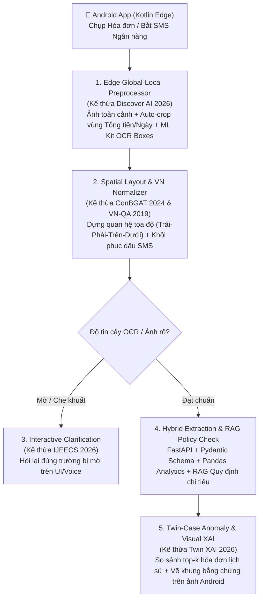

# Đề Xuất Dự Án AI Thực Chiến Để Trình Bày Với TS. Bùi Thanh Hùng

Tài liệu này thiết kế sẵn **2 phương án dự án "đo ni đóng giày"** kết hợp giữa:
1. **Đúng hướng nghiên cứu mũi nhọn 2024–2026 của TS. Bùi Thanh Hùng** (`ConBGAT`, `Global-Local VLM + XAI`, `Interactive VQA`, `Twin XAI`, `Vietnamese QA`).
2. **Đúng vũ khí sở trường của bạn** (3–5 năm kinh nghiệm Mobile Android Kotlin + Nghiệp vụ Ngân hàng/Fintech + Backend FastAPI, Pandas, Embeddings, RAG đang học).

---

## Nguyên Tắc Vàng Khi Đưa Dự Án Cho Thầy Xem

Qua phân tích 35 bài báo và 3 GitHub của học trò thầy, một dự án muốn được thầy đánh giá cao **PHẢI CÓ 4 YẾU TỐ**:
1. **Không làm "API Wrapper" đơn điệu:** Không chỉ gửi ảnh/chữ thẳng lên Gemini rồi in kết quả. Phải có **tiền xử lý thông minh** (Auto-Crop cục bộ, Đồ thị không gian OCR, hoặc Chuẩn hóa tiếng Việt).
2. **Có tính Giải thích (Explainable AI - XAI) & Chống bịa đặt:** AI phán cái gì phải chỉ ra **bằng chứng trực quan** (khoanh vùng Bounding Box trên ảnh + trích dẫn đoạn quy định `[Đoạn #...]` + so sánh ca tương đồng lịch sử `Twin Case`).
3. **Có Tương tác làm rõ (`Interactive Clarification`):** Khi ảnh mờ hoặc câu hỏi thiếu thông tin, AI biết chủ động hỏi ngược lại người dùng thay vì đoán mò.
4. **Đo lường được bằng con số (Metrics):** So sánh rõ *Baseline (gọi model trần)* vs *Pipeline đề xuất của bạn* trên 3 chỉ số: **Độ chính xác (F1 / Accuracy)**, **Tỷ lệ chống bịa (Hallucination Rejection Rate)** và **Độ trễ (Latency ms — Edge vs Cloud)**.

---

## 🏆 PHƯƠNG ÁN 1 (Đậm Chất Fintech + Trúng Trọng Tâm `ConBGAT` & `VLM-XAI`)
### Tên dự án: **`FinDoc-XAI`: Hệ thống Trích xuất Chứng từ Tài chính, Kiểm toán Chi tiêu & Hỏi đáp Thị giác Có Giải thích trên Thiết bị Di động (Edge-Cloud Multimodal Financial VQA)**

### 1. Bài toán thực tế giải quyết
Người dùng cá nhân và nhân viên doanh nghiệp tại Việt Nam hàng ngày nhận hàng chục **hóa đơn giấy chụp vội (nhăn, bóng mờ), biên lai chuyển khoản QR ngân hàng, và SMS biến động số dư không dấu**. Các app hiện tại hoặc bắt nhập tay, hoặc dùng OCR thường bị sai lệch cột tiền và không giải thích được vì sao một khoản chi bị cảnh báo bất thường.

### 2. Kiến trúc Kỹ thuật (Kế thừa 5 công trình của thầy Hùng)

### 3. Bảng ánh xạ "Điểm chạm Học thuật" khi nói chuyện với thầy

| Module trong `FinDoc-XAI` | Kế thừa từ bài báo nào của thầy? | Bạn dùng công nghệ gì đã/đang học? |
| :--- | :--- | :--- |
| **Edge Global-Local Auto-Crop** | *Global-Local Hybrid VLM* (**Discover AI, 2026**) — giải quyết trực tiếp nhược điểm độ trễ `2.23s` nêu trong bài báo! | Kotlin Android + OpenCV/Bitmap crop (gửi ảnh Global nén nhẹ + Local Patch nét cao). |
| **Spatial Box Graph Prompting** | *ConBGAT* (**PeerJ CS, 2024**) — giữ cấu trúc không gian dòng/cột của hóa đơn `SROIE`/`CORD`. | ML Kit Text Recognition lấy tọa độ `(x, y, w, h)`, ghép quan hệ láng giềng ngang/dọc đưa vào FastAPI. |
| **Interactive Clarification** | *Improved Interactivity VQA* (**IJEECS, 2026**). | Pydantic trường `needs_clarification: bool` + `clarification_question: Optional[str]`. |
| **Twin-Case Anomaly + RAG XAI** | *Twin Systems XAI* (**PeerJ CS, 2026**) + **Bài 20–21 (Embeddings & RAG)**. | Cosine Similarity tìm 3 giao dịch lịch sử giống nhất (Pandas + `gemini-embedding-001`) + vẽ Canvas Overlay khoanh đỏ dòng tiền trên Android. |
| **Khôi phục dấu SMS Ngân hàng** | *Vietnamese Diacritics & QA* (**ASTESJ, 2019**). | Tiền xử lý chuỗi SMS không dấu trước khi phân loại danh mục chi tiêu. |

### 4. Cách đánh giá thực nghiệm để đưa thầy xem
- Dùng ngay 50 ảnh hóa đơn từ tập chuẩn quốc tế **`SROIE` / `CORD`** (đúng tập dữ liệu thầy dùng trong bài `ConBGAT`!) + **30 ảnh hóa đơn/UNC tiếng Việt**.
- Kẻ bảng so sánh:
  1. *Chỉ gọi VLM bằng ảnh gốc resize nhỏ* -> hay đọc nhầm số tiền lẻ thành tổng tiền.
  2. *Dùng `Global + Local Patch + Spatial OCR Layout` của bạn* -> độ chính xác trích xuất `TOTAL` và `DATE` tăng rõ rệt, giảm dung lượng upload 65%, kèm khung giải thích XAI trực quan!

---

## 🥈 PHƯƠNG ÁN 2 (Nhanh Ra Sản Phẩm Nhất — Nâng Cấp Trực Tiếp Từ `DriveSafeAI` Của Bạn)
### Tên dự án: **`DriveSafe-XAI`: Hệ thống Co-Pilot Ô tô Đa phương thức — Chẩn đoán Đèn Cảnh báo Taplo (Global-Local VQA) & Tra cứu Sổ tay Xe Có Giải thích**

> **Lợi thế cực lớn:** Bạn **đã có sẵn Backend FastAPI (5/5 test pass), 3 Module Android (`CarNotificationListener`, `Audio Ducking`, `SilentReplySender`) và đang làm sẵn Sổ tay Xe ở `lesson21.py`**! Bạn chỉ cần gắn thêm "lõi nghiên cứu của thầy" vào là thành một đề tài cực mạnh trong thời gian ngắn nhất.

### 3 Mảnh ghép nâng cấp theo đúng hướng nghiên cứu của thầy:
1. **Chẩn đoán Đèn Cảnh báo Taplo bằng `CIE-LAB Global-Local Auto-Crop` (*Discover AI 2026*):**
   - Khi tài xế dừng xe chụp bảng đồng hồ taplo đang báo đèn lạ (đỏ/vàng), thuật toán chuyển ảnh sang hệ màu **CIE-LAB** tự động tách vùng phát sáng màu đỏ/cam bất thường cắt thành **Local Patch $128 \times 128$** (không cần train YOLO trước!), ghép cùng ảnh toàn cảnh Taplo gửi lên Backend.
2. **Tra cứu Sổ tay Xe bằng `Rule-Structured RAG` (*JAIST 2013* + *Bài 21*):**
   - Cắt sổ tay xe theo cấu trúc logic `[Tên cảnh báo] -> [Điều kiện nguy hiểm] -> [Hành động xử lý bắt buộc]`, lọc ngưỡng `min_score` chống bịa đặt, trả lời qua loa xe (Audio Ducking) kèm trích dẫn chương mục.
3. **Phân loại Mức độ Khẩn cấp Tin nhắn Tiếng Việt Không dấu + `Twin XAI` (*2019 QA* + *2026 XAI*):**
   - Tin nhắn Zalo/SMS gửi tới khi lái xe (`"anh oi con sot cao dua di vien gap"` vs `"khuyen mai giam gia 50%"`) được khôi phục dấu, đối chiếu với các mẫu tình huống khẩn cấp (`Twin Examples`) và hiển thị giải thích vì sao hệ thống quyết định ngắt nhạc để đọc to tin nhắn đó lên.

---

## Nên Chọn Phương Án Nào?

- **Chọn Phương án 2 (`DriveSafe-XAI`) nếu:** Bạn muốn **có bản Demo chạy thật trên điện thoại Android nhanh nhất (trong 1–2 tuần tới)** để đem cho thầy xem ngay, vì tận dụng được toàn bộ code `DriveSafeAI` + `lesson21.py` đang làm.
- **Chọn Phương án 1 (`FinDoc-XAI`) nếu:** Bạn muốn dự án này vừa để **nộp/báo cáo thầy Hùng** (rất gần bài `ConBGAT` trên tập hóa đơn `SROIE`), vừa làm **Project Đinh trong CV ứng tuyển Fintech/Ngân hàng lương 28–33 triệu**! *(Thực tế phần lõi Python FastAPI + Global-Local + RAG + XAI của cả hai bài giống nhau tới 80%)*.

---

## Kịch Bản Mở Lời Khi Gặp / Nhắn Cho Thầy Hùng

Bạn có thể nói (hoặc viết email/tin nhắn) theo cấu trúc ngắn gọn, lễ phép và cực kỳ chuyên nghiệp sau:

> *"Thưa thầy, em đã đọc kỹ các hướng nghiên cứu trên trang của thầy, đặc biệt em rất ấn tượng với cơ chế kết hợp bố cục không gian trong bài **ConBGAT (2024)**, nhánh cắt tự động **Global-Local VLM kèm giải thích XAI (2026)** và cơ chế hỏi làm rõ trong **Interactive VQA (2026)**.*
>
> *Vì em đang có nền tảng phát triển Mobile Android và nghiệp vụ tài chính, em dự định xây dựng một hệ thống **Edge-Cloud Multimodal VQA & Explainable RAG** (tiền xử lý Global-Local & OCR không gian ngay trên thiết bị Android để giảm độ trễ, kết hợp Backend đối chiếu quy định bằng RAG và giải thích vùng bằng chứng trực quan trên ảnh). Em xin phép dựng bản prototype đầu tiên kèm số liệu thử nghiệm để nhờ thầy góp ý định hướng thêm ạ!"*
